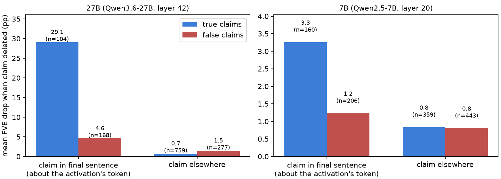

# Open-NLA deletion effects replicate in the mean, but do not reliably verify individual claims

### A replication and stress test of claim deletion and paraphrase scoring

**Abstract.** [Natural Language Autoencoders (NLAs)](https://transformer-circuits.pub/2026/nla/) map a model
activation to a text explanation and back again. Their authors report that deleting true claims from an explanation
hurts reconstruction more than deleting false claims, while warning that this is a noisy per-claim signal. I test that
claim on two released NLAs—Qwen2.5-7B layer 20 and Qwen3.6-27B layer 42—using 100 truncated Re-DocRED Wikipedia
prefixes. The aggregate deletion effect reproduces in direction, but individual-claim discrimination is chance-level
on 27B and weak on 7B. The observed true–false gap is concentrated in claims from the final verbalizer sentence.
Sentence-level heavy paraphrase adds no reliable discrimination. These results qualify this deletion score as a
per-claim verifier in this evaluation; they do not establish a general property of NLAs.

## Question and main result

For each final-token activation, I generate an NLA explanation, split it into atomic claims, label claims against the
visible source prefix, and measure the FVE drop after deleting each claim. FVE is the fraction of activation variance
explained by reconstruction; a larger drop means the deleted text mattered more to the AR.

| model | scored true / false claims | mean deletion drop, true / false (pp) | per-claim AUROC, 95% document-bootstrap CI |
|---|---:|---:|---:|
| Qwen2.5-7B, layer 20 | 519 / 649 | 1.58 / 0.94 | 0.581 [0.551, 0.613] |
| Qwen3.6-27B, layer 42 | 863 / 445 | 4.15 / 2.66 | 0.490 [0.451, 0.529] |

Thus deletion reproduces the aggregate direction, but is not a reliable individual-claim truth score here: 27B is at
chance and 7B is weak. Heavy paraphrase did not improve discrimination: the 27B mean drop was 0.09 pp for true versus
0.20 pp for false claims, while 7B drops were about 17 pp for both classes.

## Where the deletion gap appears

The aggregate gap is concentrated in claims from the final verbalizer sentence. The corresponding claims elsewhere in
the explanation show no true-over-false advantage on either model.

| model | final verbalizer sentence: true / false drop (pp) | elsewhere: true / false drop (pp) |
|---|---:|---:|
| 7B | 3.26 / 1.23 | 0.84 / 0.81 |
| 27B | 29.09 / 4.60 | 0.73 / 1.48 |



This is a positional observation, not a demonstrated mechanism. One possible explanation is that final verbalizer
sentences disproportionately describe information associated with the source prefix's ending, such as its final token
or an incomplete final phrase. The present experiment does not test that explanation directly.

## Scope, alternative explanations, and limitations

- **Model and protocol specificity.** These are two released open NLAs, not Anthropic's proprietary Claude NLAs.
  Results may depend on NLA training, target model, layer, explanation format, dataset, or activation location.
- **Claim-type confounding.** In final sentences, token-identity claims are rarely false (6/100 on 7B; 5/76 on 27B),
  whereas attributes and identifications are often false. The residual gap may therefore compare claim types rather
  than truth.
- **Text-editing and annotation limits.** Deletion changes the AR's token sequence as well as a claim's meaning.
  Labels are Claude-produced and provisional; a 17-claim blind check agreed on 14 initially, with two human mistakes
  and one Claude error. Heavy paraphrases are scored per sentence, so claims in one sentence share a score.
- **Pilot-scale evidence.** There are 100 documents, and 27B mean effects are outlier-heavy. Claims within documents
  are dependent, and the final-sentence/locality analysis is exploratory.
- **27B setup deviation.** The released pair has no separate target model: activations use `av_base` warm-start LoRA
  merged weights, and the FVE denominator is computed from the 100 pilot activations.

**Relation to the original NLA evaluation.** Anthropic reports claim deletion across explanations, but not a breakdown
by claim position in the verbalizer output. It is therefore unknown whether its aggregate result would persist after
excluding final-sentence claims, or whether the same positional pattern occurs in its models. Its result and this one
are not directly contradictory: its evaluation uses proprietary Claude NLAs and pretraining-like text, while this one
uses released 7B/27B NLAs and truncated Re-DocRED prefixes. Differences could reflect model family, training run,
dataset, activation location, claim-extraction protocol, or an unreported positional analysis.

## Methods at a glance

- **Data:** 100 Re-DocRED Wikipedia introductions, each cut at a word boundary; the activation is read at its final
  token.
- **Claims:** explanations are split into atomic true, false, and irrelevant claims against the prefix and Re-DocRED
  annotations; see [the annotation guide](fve_claims/ANNOTATION_GUIDE.md).
- **Edits:** deletions remove exact claim spans mechanically; heavy paraphrases rewrite an entire sentence while
  preserving its propositions.
- **Analysis:** report FVE-drop means, document-cluster bootstrap intervals, and per-claim AUROC. Headline and audit
  scripts read committed data artifacts.

## Reproducing the headline

```sh
uv run python fve_claims/audit/headline_table.py       # deletion and paraphrase drops, document-bootstrap intervals
uv run python fve_claims/audit/auroc_and_position.py   # AUROC and the final-sentence split
uv run python fve_claims/audit/random_examples.py      # two random documents: explanation, claims, labels, drops
uv run python fve_claims/audit/make_spotcheck.py       # blind label check; score with score_spotcheck.py
```

## Layout

| path | what |
|---|---|
| `fve_claims/` | the experiment: claims, labels, edits, scores, analysis |
| `fve_claims/analysis_27b/` | one script per reported number (see its README) |
| `fve_claims/audit/` | verification: blind label check, re-derivations, random examples |
| `fve_claims/audit/out/` | blind label check (sheet and key) and the paraphrase samples |
| `src/`, `scripts/` | 7B NLA library and model loader; dataset builder and checkpoint setup for both NLAs |
| `PROVENANCE.md` | what the human decided, checked and found by hand |

Agents wrote most of the code and produced the provisional claim labels; the research decisions, the audits and
the conclusions are mine. `PROVENANCE.md` records which is which.
